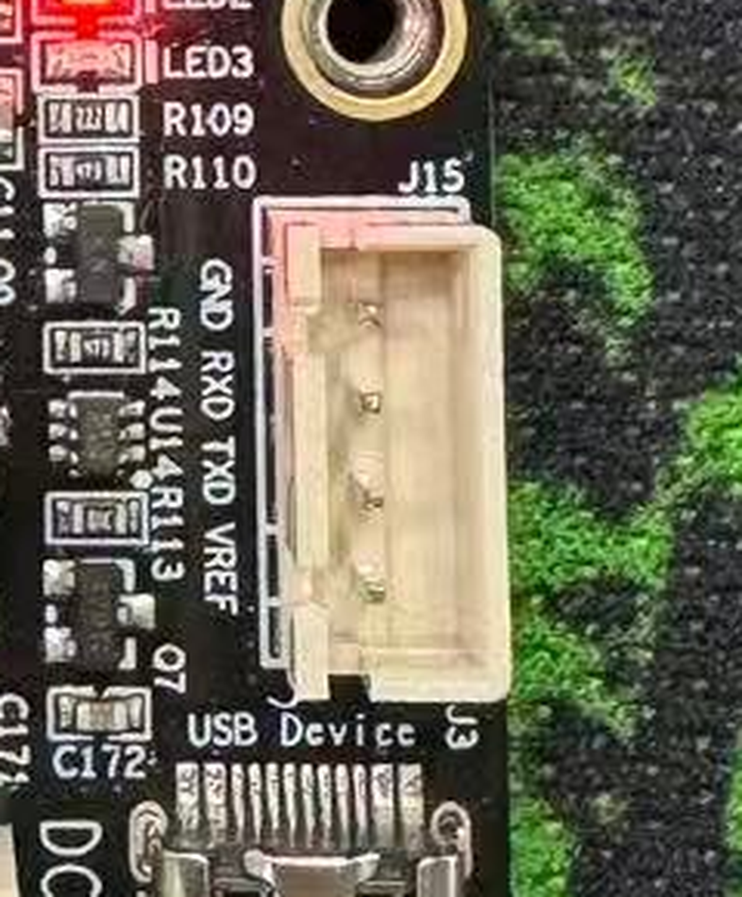

# i.MX6ULL 嵌入式 Linux 入门路线图

**面向对象**：4 年 MCU（STM32 一类）开发经验，第一次正式做 Linux 的工程师
**硬件**：野火 i.MX6ULL Mini（Cortex-A7 单核，512MB DDR3，8GB eMMC），调试串口接 Windows `COM8`
**周期**：8 周 × 每周 12~15 小时（按里程碑推进，不按周死磕）
**最终产出**：一个跑在自己板子上的「工业数据采集网关」——自定义内核驱动 + 多线程用户态程序 + Web/MQTT 上报 + systemd 托管

---

## 0. 这份教程的定位

野火自己的《i.MX6ULL Linux 开发指南》有 1000+ 页，写得很全，但**不适合当第一本书读**。它的问题不是内容错，是**顺序错**：大量的环境搭建、内核移植细节堆在前面，新手很容易在第 3 周还没让一颗 LED 在自己写的驱动下亮起来，然后放弃。

所以这份路线图的核心原则只有一条：

> **每 3~5 天必须闭环一次：写代码 → 编译 → 部署到板子 → 看到预期现象。**
> 任何超过一周没有「可见结果」的学习内容，都往后放。

配套代码在 `imx6ull-bootcamp/` 目录，M0/M3/M4 的可编译工程已经写好，直接用。

---

## 1. 你手上这套硬件（先认清边界）

| 项目 | 说明 |
|---|---|
| SoC | NXP i.MX6ULL，Cortex-A7 **单核**，带 NEON/FPU，主频 528 或 792MHz（看核心板丝印） |
| 内存 | 512MB DDR3L（你终于不用数 RAM 了，但也别乱开进程） |
| 存储 | 8GB eMMC（另有 SD 卡槽，学习期强烈建议插一张 SD 卡做实验） |
| 调试口 | UART1 → 板载 CH340 → Windows 的 `COM8`，**115200 8N1，无流控** |
| 网络 | **2 路 10/100M 以太网（ETH1 / ETH2，J11 / J12）**，网口座是 HanRun HR9111105A（集成变压器）；学习期它们是**生命线**（tftp + nfs + ssh 全靠它） |
| 其它 | USB Host/OTG、CAN、RS485、音频、LCD、摄像头、WiFi |

### 1.1 你这块板子的实测档案（2026-11-11 从串口读出，非猜测）

> 这一节是**实测**，不是通用描述。教程后面所有涉及具体名字/编号的地方，都以这张表为准。

| 项目 | 实测值 |
|---|---|
| 内核 | `4.19.35-imx6`（`#1.2508stable`，`PREEMPT`，2025-08-23 编译） |
| 发行版 | Debian GNU/Linux 10 (**buster**)，`embedfire.com Debian Image 2025-08-23` |
| 设备树 | `model = "Embedfire i.MX6ULL Board"`，`compatible = fsl,imx6ull-14x14-evk, fsl,imx6ull` |
| 登录用户 | **`debian`（uid 1000），不是 root**；组含 `gpio / i2c / spi / dialout / admin` |
| sudo | `sudo -n` 失败 → **必须有密码才能提权**（这是你眼下第一个硬门槛，见 §6.0） |
| eMMC | `mmcblk1` 7.3G：`p1` 40M **FAT** 挂 `/boot`；`p2` 7.2G **ext4** 挂 `/`；`boot0/boot1` 各 4M 存 U-Boot |
| `/boot` 内容 | `kernel/vmlinuz-4.19.35-imx6`、`initrd.img-...`、`config-...`、`System.map-...`、`uEnv.txt`、`dtbs/overlays/` |
| 启动机制 | **U-Boot + `uEnv.txt` + `.dtbo` overlay**（`enable_uboot_overlays=1`）——**不是**重编整份 dtb |
| 模块目录 | `/lib/modules/4.19.35-imx6/`，**没有 `build` 软链** → 模块只能在 Ubuntu 主机上编，板上编不了 |
| 网口 | **`eth1` / `eth2`（根本没有 eth0！）**；另有 `usb0` = `192.168.7.2`（USB gadget 网卡） |
| GPIO | `gpiochip0..4` = GPIO1~GPIO5 各 32 线；`gpiochip5` = `74hc595` 扩展芯片 8 线 |
| RGB LED | **已被 `leds-gpio` 占用**：红=`GPIO1_IO04`、绿=`GPIO3_IO20`、蓝=`GPIO3_IO19`，均 active-low，`max_brightness=255` |
| 其它已占用 | `cpu` 心跳灯=`GPIO4_IO03`；按键 `Key 0`=`GPIO4_IO01`；74HC595 的 cs/mosi/sck=`GPIO4_IO7/10/11` |
| CAN | **未启用**（`ip link show type can` 输出为空）→ 要用 CAN 必须在 `uEnv.txt` 打开 `imx-fire-can1.dtbo` |
| 内核配置 | `/boot/kernel/config-4.19.35-imx6`（143KB）——"这个内核到底开了什么"的唯一权威答案 |
| 可用的 overlay | `i2c1/2/3/4`、`ecspi1/2/3/4`、`can1/2`、`485r1/r2`、`adc1`、`hdmi`、`lcd`、`key`、`led`、`pwm-led`、`mpu6050`、`dht11`、`ds18b20`、`cam`、`btwifi` … 共 40 个 |
| **控制台拓扑** | 板上**没有 USB 转串口芯片**。`COM8` = micro-USB「USB Device」口的 gadget 串口（`ttyGS0`），Linux 起来后才有；真·调试口是 **J15 四针排针（GND / RXD / TXD / VREF）**，需外接 USB-TTL（详见 §7.0） |
| 编译工具链 | 内核由 `gcc 7.5.0 (Linaro / Ubuntu 18.04)` 编译 → **编模块请用同一版本**，否则 vermagic/ABI 风险 |
| 内存真相 | CMA 预留了 **320MB**（给摄像头/LCD），`free` 看到的很多是 CMA 可回收页，实际可用约 **160MB** |
| RTC | 无电池，开机时间从 `2019-02-14` 起（`journalctl` 里时间戳全错）→ 联网后必须校时，否则 TLS 证书校验会失败 |
| journal | **volatile 模式**（`--list-boots` 只有当前一次）→ 重启前的日志会丢，重要日志要自己落盘 |

**几个和 MCU 完全不同的现实**，先接受它：

1. **串口只是控制台，不是调试器。** 没有 SWD、没有断点、不能单步看寄存器。你 90% 的调试手段是 `printk` + `dmesg` + 日志。
2. **板子上跑的不是「你的程序」，是一个完整操作系统。** 你的代码只是 `/` 文件系统里的一个可执行文件，或者内核里的一个 `.ko`。
3. **烧录这件事的复杂度提升了一个数量级。** MCU 是「点下载」，这里是「U-Boot 引导 + 分区 + 根文件系统」三个独立的东西。

---

## 2. 先修两个 Windows 侧的坑

### 2.1 执行策略禁止运行脚本（你现在遇到的）

现象：

```
无法加载文件 ...\serial-log.ps1，因为在此系统上禁止运行脚本。
FullyQualifiedErrorId : UnauthorizedAccess
```

原因不是脚本坏了，也不是权限不足，而是 **PowerShell 执行策略（ExecutionPolicy）**。Windows 客户端默认值是 `Restricted` —— 禁止运行任何 `.ps1`。你机器上实测：

```
MachinePolicy  Undefined
   UserPolicy  Undefined
      Process  Undefined
  CurrentUser  Undefined
 LocalMachine  Undefined
```

全部未设置 → 落到系统默认 `Restricted`。三种解法，按影响范围从小到大：

| 方案 | 命令 | 影响 |
|---|---|---|
| **只作用于这一次**（建议先用这个验证） | `powershell -ExecutionPolicy Bypass -File .\imx6ull-bootcamp\tools\serial-log.ps1 -Port COM8 -Seconds 30` | 零改动，仅这一条命令生效 |
| 只作用于当前窗口 | `Set-ExecutionPolicy -Scope Process -ExecutionPolicy Bypass` | 关掉窗口即失效 |
| **一次性永久解决**（推荐，不需要管理员） | `Set-ExecutionPolicy -Scope CurrentUser -ExecutionPolicy RemoteSigned` | 仅对本用户生效；本地脚本可跑，网上下载的仍需签名 |

> 想恢复原状：`Set-ExecutionPolicy -Scope CurrentUser -ExecutionPolicy Undefined`。

三个常见误区：

- **别用 `Unblock-File`**。它只清除"文件来自网络"的标记（`Zone.Identifier` 备用数据流）；实测你这个文件只有 `:$DATA` 流、没有该标记，所以对它无效。
- **别用「以管理员身份运行」**。`Restricted` 是策略问题不是权限问题，提权照样拦。
- **`Bypass` 必须写在启动参数里**。在已经打开的窗口里执行 `Set-ExecutionPolicy Bypass` 对当前会话可能不生效（受 MachinePolicy 约束时），用 `-File` 方式最稳。

### 2.2 COM8 被占用

实测结论：这块板子的 USB 串口枚举正常（`\Device\USBSER001` → `COM8`），但**打开时返回「访问被拒绝」**，而 COM1/COM4 都能正常打开。这说明端口被别的进程独占持有，不是驱动问题、不是权限问题。

处置：

1. 关掉正在用它的程序：串口助手（野火资料里的 `XCOM`/`SSCOM`）、MobaXterm、Xshell、SecureCRT、VS Code 的 Serial Monitor 扩展、PlatformIO —— 任一在跑就会独占。
2. 不确定是谁占的：用 **Process Explorer**（微软 Sysinternals），`Ctrl+F` 搜索 `COM8`，直接定位持有句柄的进程。
3. 确认释放后，用本仓库脚本验一下并顺手抓启动日志：

```powershell
# 只监听 20 秒（此时给板子断电再上电，能抓到完整启动日志）
.\imx6ull-bootcamp\tools\serial-log.ps1 -Port COM8 -Seconds 20

# 板子已经启动好的情况下，发回车看有没有 shell 提示符
.\imx6ull-bootcamp\tools\serial-log.ps1 -Port COM8 -Seconds 8 -Nudge
```

> 学习期的固定动作：**每次板子起不来，第一件事就是抓一份完整串口日志存盘**。这是你唯一能看到「死在哪一步」的窗口。

---

## 3. 心智模型：把你 4 年的 MCU 经验迁移过来

这是整份教程最重要的一节。**你已有的知识 70% 有用，30% 会主动骗你。**

### 3.1 映射表

| 概念 | MCU（STM32 裸机/RTOS） | i.MX6ULL + Linux | 迁移风险 |
|---|---|---|---|
| 启动 | Reset_Handler → `main()` | BootROM → SPL → U-Boot → kernel → `/sbin/init`(PID 1) | ⚠️ 你的代码不是最先跑的 |
| 代码位置 | 全部在同一地址空间 | **用户态**（受限） / **内核态**（特权）两级 | ⚠️ 高，这是根本差异 |
| 内存 | 链接脚本固定地址，指针=物理地址 | MMU + 虚拟地址，用户态指针与物理地址无关 | ⚠️ 高 |
| 寄存器操作 | `*(volatile uint32_t*)0x40020000` | 内核里 `ioremap()` + `readl/writel()`；用户态**根本不能碰** | ⚠️ 高 |
| 外设初始化 | 手写时钟/引脚/外设寄存器序列 | **设备树**描述硬件 + **子系统**（gpio/i2c/spi/can）驱动 | ⚠️ 高，思维方式要换 |
| 引脚复用 | `GPIO_InitStruct` 配 AF | pinctrl 子系统 + dts 里 `fsl,pins` | 中 |
| 中断 | NVIC，ISR 里想干啥干啥 | GIC，**上半部不能睡眠、不能耗时**，重活丢给下半部 | ⚠️ 高，最容易写出 panic |
| 延时 | `delay_ms()` 忙等 | 进程上下文用 `msleep()`；**原子上下文禁止睡眠** | ⚠️ 高 |
| 并发 | 主循环 + 中断 | 多进程/多线程/内核抢占/SMP 式并发，必须加锁 | ⚠️ 高 |
| 任务调度 | FreeRTOS task | 进程 / pthread | 低，概念直通 |
| 任务通信 | 队列/信号量/事件组 | pipe/socket/共享内存/mutex/sem | 低，概念直通 |
| 定时器 | TIM + 中断 | `timerfd`/`hrtimer`/`poll` 超时 | 中 |
| 看门狗 | IWDG | `/dev/watchdog` + systemd | 低 |
| Flash 布局 | 0x08000000 起 | eMMC 分区：raw(uboot) + FAT(kernel/dtb) + ext4(rootfs) | ⚠️ 中 |
| 调试 | SWD 断点/看变量 | `printk` + `dmesg -w`、`strace`、`gdbserver`、`/proc`、`/sys` | ⚠️ 高，心理落差大 |
| 交付 | 烧 hex，完事 | rootfs + 启动脚本 + 服务托管 + 升级策略 + 掉电保护 | ⚠️ 高，工程化成分陡增 |

### 3.2 你会踩的五个思维陷阱

1. **"为什么我 include 了头文件还是找不到寄存器宏？"**
   因为用户态程序不能直接操作寄存器。想点灯有三条路：`/sys/class/gpio`（老）、`libgpiod`（推荐）、写内核驱动（正统）。**先学第三条**，因为你要学的就是驱动。

2. **"我 `printf` 没输出就崩了"**
   MCU 上是 HardFault 进死循环，这里是 `Segmentation fault` 进程直接被杀，系统照常运行。学会看 `dmesg` 里的 `segfault at ...` 和用 `gdb`/`core` 文件。

3. **"内核模块里 `msleep` 一下怎么就 panic 了"**
   中断上下文/持有自旋锁时睡眠 = 内核崩溃。这是 Linux 驱动第一定律。

4. **"我 `./app` 说 `No such file or directory`，但文件明明在"**
   十有八九是**动态链接器缺失**（rootfs 里没有 `/lib/ld-linux-armhf.so.3`），不是文件不存在。用 `readelf -l` 看 `interpreter`，或先静态链接验证。

5. **"改了内核，板子起不来了"**
   所以 M1 必须先学会 **tftp 启动**——它就是你的「不烧录也能试错」的安全网。

---

## 4. 开发主机与工具链

### 4.1 选一台 Linux 构建机（M-1，1 天）

你现在的 Windows 上 **没有 WSL、没有 Docker、没有 gcc/make**，所以这一步是硬门槛。三个方案：

| 方案 | 适合 | 优点 | 坑 |
|---|---|---|---|
| **VMware + Ubuntu 22.04 桌面版**（推荐） | 第一次做 Linux | 野火文档全按这个写；NFS/tftp/桥接网络/串口透传都成熟；出问题搜得到答案 | 吃 8GB 内存 + 100GB 磁盘 |
| WSL2 + Ubuntu 22.04 | 想轻量 | 启动快，和 Windows 文件互通 | **桥接网络要折腾**（板子 ping 不到 WSL）；tftp/NFS 服务端配置别扭；老内核（4.19）编译偶发问题 |
| 物理机装 Ubuntu | 长期做这行 | 性能和 IO 最好 | 装系统成本高 |

**结论：第一周别在环境上「优化」，直接用 VMware + Ubuntu 22.04。** 你的机器 28 核，给虚拟机 8 核 / 8GB / 100GB 完全够。

#### 具体配置（你的 Windows 上 VMware 已装好，VMnet1/VMnet8 都在）

| 项 | 值 | 理由 |
|---|---|---|
| CPU | 8 核 | 编内核 `make -j8` 才快 |
| 内存 | 8 GB | 编译 + 跑 tftp/NFS 服务 |
| 磁盘 | 100 GB（单文件） | 内核源码 + 构建产物 + 根文件系统 |
| 网络 | **桥接 Bridged** | 板子和 VM 必须同网段，tftp/NFS 才通 |

> ⚠️ **别用 NAT**。NAT 模式下板子 ping 不到 VM，tftp/NFS 全部失效，这是新手第一大坑。桥接后 VM 会自动拿到 `192.168.11.x`，和你 Windows 同网段。

装完先在 Ubuntu 里确认三件事：

```bash
ping -c 2 archive.ubuntu.com     # 1) 能上网
ip -br addr                      # 2) 记下 VM 的 IP，后面当 serverip 用
sudo apt update                  # 3) 源正常
```

板子侧（网线插 **ETH1** 或 **ETH2**，插上先看网口灯亮不亮）：

```bash
sudo dhclient eth1 || sudo udhcpc -i eth1     # 拿 IP（哪个口有载波用哪个）
ip -br addr                                   # 记下 192.168.11.x
ping -c 3 <VM 的 IP>                          # 必须通
```

> 你这块板子有两个网口，但**没有 eth0**。插线后先 `cat /sys/class/net/eth1/carrier`，输出 `1` 的那个才是有网线的口。

Ubuntu 里一次装齐：

```bash
sudo apt update
sudo apt install -y build-essential git vim \
    gcc-arm-linux-gnueabihf \
    tftp-hpa tftpd-hpa nfs-kernel-server \
    minicom device-tree-compiler bc bison flex libssl-dev \
    libncurses-dev u-boot-tools net-tools openssh-server
```

> 懒得手敲？直接跑配套脚本 —— 它会连 tftp 服务、NFS 导出、目录结构一起配好：
>
> ```bash
> cd imx6ull-bootcamp/tools
> chmod +x setup-ubuntu.sh && ./setup-ubuntu.sh
> ```
>
> 跑完会打印 VM 的 IP 和一堆"在板子上验证"的命令，照着复制即可。

> **工具链版本策略**：先用野火 SDK 里那套 **`gcc 7.5.0`（Linaro / Ubuntu 18.04）** 把**内核 + 模块**跑通 —— 这不是猜的，板上 `dmesg` 第一行就写着 `gcc version 7.5.0`，你的模块必须和它对齐，否则 `insmod` 可能 `Invalid module format`。别一上来就用 apt 的 gcc 11/12 编内核：老内核（4.19）配新 GCC 会有一堆 `-Werror` 和语法误报，那是给老手排错的，不是给你学入门的。
> 用户态程序可以另外用 apt 的新版工具链，两套并存、用 `PATH` 切换。

### 4.2 目录规划（一开始就分好，省后面无数麻烦）

```
~/imx6ull/
├── toolchain/          # 交叉编译器（野火 SDK 解压到这里）
├── uboot/              # u-boot 源码
├── kernel/             # 内核源码（linux-imx）
├── rootfs/             # 根文件系统构建目录（buildroot 产物）
├── tftpboot/           # tftp 服务根目录（zImage、dtb 放这里）
├── nfsroot/            # NFS 共享目录（你的 app 放这里，板子直接跑）
├── module/             # 你自己写的驱动
└── app/                # 你自己写的应用
```

### 4.3 网络拓扑（桥接，同网段）

```
Windows(宿主) ── VMware 桥接 ── Ubuntu: 192.168.1.100
                                        │
                              ┌─────────┴─────────┐
                        i.MX6ULL 板子: 192.168.1.50
```

板子侧配静态 IP（写进 U-Boot `bootargs` 或用 `ip` 命令临时配）：

```bash
# 板子上执行（eth0 名字以 ip link 为准）
ip addr add 192.168.1.50/24 dev eth0
ip link set eth0 up
ping -c 3 192.168.1.100      # 必须通，不通后面全废
```

---

## 5. 路线图总览

| 里程碑 | 主题 | 时间 | 交付物（必须亲手做出来） | 验收标准 |
|---|---|---|---|---|
| **M0** | 打通第一条闭环 | 2~3 天 | 交叉编译的 `hello` 在板子上跑起来；tftp、NFS、ssh 全通 | 板子能 `mount -t nfs` 挂上 Ubuntu 目录并执行其中的程序 |
| **M1** | 启动链路解剖 | 3~4 天 | U-Boot 命令熟练；用 tftp 启动一次内核（不动 eMMC） | 能说清 BootROM→SPL→U-Boot→kernel→rootfs 每一步在哪、怎么验证 |
| **M2** | 内核与设备树 | 4~5 天 | 改 dts 里的 `model` 字符串，重编 dtb，tftp 启动后 `/proc/device-tree/model` 变了 | 能独立找到「我板子对应的 dts 和 defconfig」并编译出 zImage+dtb |
| **M3** | 第一个内核模块 | 3~4 天 | `hello_module` + 参数 + 字符设备，`insmod`/`rmmod` 干净 | `dmesg` 无 oops，`rmmod` 100 次不崩、不泄漏 |
| **M4** | GPIO 驱动（核心） | 4~5 天 | 设备树描述的 LED 字符驱动 + 用户态测试程序 | `echo 1 > /dev/ebf_led` 灯亮；`rmmod` 后无残留 |
| **M5** | 用户态工程化 | 4~5 天 | 多线程采集程序（采集/上报/看护三线程）+ Makefile/CMake | 能响应 `SIGTERM` 优雅退出；能交叉编译第三方库（libmodbus/mosquitto） |
| **M6** | 系统集成 | 3~4 天 | systemd 服务 + 看门狗 + 日志 | 断电重启自恢复；`kill -9` 后 5 秒内被拉起 |
| **M7** | 综合项目 | 2~4 周 | EBF-Gateway（见第 13 节） | 见项目验收清单 |

**总计 8 周左右。** 如果你只有周末，按里程碑走，不要按周走。

---

## 6. M0：打通第一条闭环（最关键的一步）

目标：**在 Ubuntu 上写的代码，能出现在板子上并运行。** 这一步打通，后面才有迭代速度。

### 6.0 先把 sudo 权限打通（不解决这个，后面寸步难行）

实测：`debian` 用户可用，但 `sudo -n` 失败 → **需要密码**。而下面这些操作全都需要 root：

| 操作 | 为什么要 root |
|---|---|
| `insmod` / `rmmod` | 内核空间操作 |
| 写 `/dev/ebf_led` | 你的驱动创建设备节点，默认 `root:root 0600` |
| 写 `/sys/class/leds/*/brightness` | 实测 `root:root 0644`，debian 用户写 → `Permission denied` |
| 改 `/boot/uEnv.txt` | 启动配置 |
| `mount` NFS | 挂载需要 `CAP_SYS_ADMIN` |
| 读写 `/dev/i2c-*` | 实测 `root:root 0600`（虽然你在 i2c 组里，但 udev 没给组权限） |

**方案 A（优先）：找野火资料里的默认密码。**
这套镜像是 `embedfire.com Debian Image 2025-08-23`，账号 `debian`。野火文档/网盘里的"镜像说明"页会写密码。厂商常见默认值可以依次试：`root`、`123456`、`debian`、`temppwd`。

```bash
sudo -v      # 提示输密码，对了就通过
```

**方案 B（兜底）：用 U-Boot 重置密码。**
你有串口控制权，这是完全合法的自救手段（不会损坏系统）：

```text
1. 上电，3 秒倒计时内狂按任意键，停在 U-Boot 的 =>
2. printenv bootargs          # 先把原参数记下来
3. setenv bootargs 'console=ttymxc0 root=/dev/mmcblk1p2 rw rootfstype=ext4 rootwait init=/bin/bash'
4. bootz <zImage 地址> - <dtb 地址>     # 或 run bootcmd
5. 直接拿到 root# 提示符（没有 systemd）：
   mount -o remount,rw /
   passwd debian
   sync
   reboot
6. 重启后恢复 bootargs，或 saveenv
```

> ⚠️ 这块板子带 initrd（`/boot/kernel/initrd.img-4.19.35-imx6`）。若 `init=/bin/bash` 落到了 initrd 而不是真根文件系统，改用 `rdinit=/bin/sh` 再试。

**方案 C（知道密码后，图学习效率）**：给 `debian` 免密 sudo。

```bash
echo "debian ALL=(ALL) NOPASSWD:ALL" | sudo tee /etc/sudoers.d/debian
sudo chmod 440 /etc/sudoers.d/debian
```

> 个人学习板这么干完全没问题，能省掉每天上百次输密码。**但绝不要在产品上这么做。**

### Day 1｜串口 + 登录 + 认清系统

```powershell
# Windows 侧，先抓 30 秒启动日志（期间给板子断电再上电）
.\imx6ull-bootcamp\tools\serial-log.ps1 -Port COM8 -Seconds 30
```

登录后（**实测账号是 `debian`，不是 root**；密码怎么拿到见 §6.0）先做一份「系统体检」，把结果记下来 —— 下面这些命令**全部不需要 root**：

```bash
uname -a                              # 内核版本，例如 4.19.35
cat /proc/device-tree/model           # 板型
cat /proc/cmdline                     # 启动参数 ← 这一行信息量极大
cat /proc/cpuinfo | head -20          # CPU/架构
free -m                               # 内存
lsblk                                 # eMMC/SD 分区布局
df -h                                 # 根文件系统在哪、多大、读写还是只读
ip addr                               # 网口名字
dmesg | head -60                      # 启动日志前 60 行
```

> **MCU 习惯迁移**：`/proc` 和 `/sys` 就是 Linux 的「寄存器手册」。想知道内核看到了什么硬件，先 `ls /proc/device-tree/` 和 `ls /sys/class/`。

### Day 2｜让板子联网

```bash
# 板子
ip addr add 192.168.1.50/24 dev eth0
ip link set eth0 up
ping -c 3 192.168.1.100
```

不通就排查：VMware 是否「桥接」而非 NAT、Windows 防火墙、网线是否插在板子的 eth0 而不是别的口、`ethtool eth0` 看 link 状态。

### Day 3｜tftp + NFS + ssh 三件套

Ubuntu 侧：

```bash
# tftp（U-Boot 取内核用）
# 注意：heredoc 用 <<EOF 而不是 <<'EOF'，否则 $USER 不会展开，路径会变成字面量 "/home/$USER/..."
sudo tee /etc/default/tftpd-hpa >/dev/null <<EOF
TFTP_USERNAME="tftp"
TFTP_DIRECTORY="$HOME/imx6ull/tftpboot"
TFTP_ADDRESS="0.0.0.0:69"
TFTP_OPTIONS="--secure --create"
EOF
mkdir -p ~/imx6ull/tftpboot
sudo chown -R tftp:tftp ~/imx6ull/tftpboot   # 或 chmod 777，学习期图省事
sudo systemctl restart tftpd-hpa
sudo systemctl status tftpd-hpa --no-pager

# NFS（板子挂你的 app 目录，改代码不用 scp）
echo "/home/$USER/imx6ull/nfsroot *(rw,sync,no_subtree_check,no_root_squash)" | sudo tee -a /etc/exports
sudo exportfs -arv
```

板子侧验证：

```bash
mount -t nfs -o nolock,vers=3 192.168.1.100:/home/xxx/imx6ull/nfsroot /mnt
ls /mnt
```

> **为什么 NFS 是效率分水岭**：没有 NFS，你每改一行代码就要 `scp` 一次；有 NFS，板子直接执行 Ubuntu 上的文件，改完立刻跑。M5 之后你每天会感谢这一步。

### Day 4｜第一个交叉编译程序

```bash
cd ~/imx6ull/app
cp -r /path/to/imx6ull-bootcamp/m0-hello/* .
make CROSS_COMPILE=arm-linux-gnueabihf-
file hello
# 期望: ELF 32-bit LSB executable, ARM, EABI5 ...
```

**坑**：在 Ubuntu 上 `ldd hello` 会报错或无输出——因为架构不同，`ldd` 根本跑不了它。用：

```bash
arm-linux-gnueabihf-readelf -d hello | head    # 看 NEEDED 依赖
arm-linux-gnueabihf-readelf -l hello | grep interpreter   # 看动态链接器路径
```

拷到板子跑：

```bash
scp hello root@192.168.1.50:/root/     # 或直接 cp 到 nfsroot/
# 板子上
./hello
```

**M0 验收**：板子通过 NFS 执行 Ubuntu 上的 `hello`，`uname -a` 打印出 4.19.x 的 ARM 内核 —— 闭环成立。

---

## 7. M1：启动链路解剖

### 7.0 ⚠️ 先确认你有一个"看得见 U-Boot 的窗口"

这是我在你板子上实测出来的、**最容易卡住 M1 的一件事**：

| 端口 | 实际是什么 | 什么时候存在 |
|---|---|---|
| `COM8` | **USB gadget 串口（`ttyGS0`）**，由 Linux 的 `g_multi` 模块提供 | **Linux 启动完成之后**。实测重启时它会消失 21~24 秒 |
| UART1 (`ttymxc0`) | 真正的调试串口，U-Boot 和内核日志都走这里 | 上电即有（BootROM 之后） |

证据：`dmesg` 里 `console [ttymxc0] enabled`，且 `serial-getty@ttymxc0.service` 在跑；而整个重启过程中你的 `COM8` 一个字节都收不到。

**结论：在你把这根 UART 接到 PC 之前，你永远看不到 U-Boot。**

好消息：**只需要一根十几块钱的 USB-TTL 线，而且不用等它到货就能先干别的活。**

#### J15 调试串口针脚（按板子丝印，从上到下）



| 针 | 丝印 | 接到 USB-TTL 适配器 |
|---|---|---|
| 1 | `GND` | GND |
| 2 | `RXD` | **适配器的 TX**（交叉） |
| 3 | `TXD` | **适配器的 RX**（交叉） |
| 4 | `VREF` | **不接**（板子侧参考/供电脚，接上去有倒灌风险） |

> ⚠️ 三条铁律，违反任一条都会让你白折腾一晚上：
> 1. **TX/RX 必须交叉**。直连是最典型的「接上了但一个字都没有」。
> 2. **只接三根**：GND、RX、TX。`VREF` 留空。
> 3. 适配器必须选 **3.3V 电平**。CH340/CP2102 模块通常有 3.3V/5V 跳线，**拨到 3.3V**；i.MX6ULL 的 IO 不耐 5V。

> 🛡️ 第一次接线前的保险动作：先只接 GND，用万用表蜂鸣档确认 J15 的 1 脚确实与板子 GND（比如 DC 座外圈）导通，再接信号线。接反 VREF 是最容易烧 IO 的操作。

#### 买什么

| 方案 | 东西 | 说明 |
|---|---|---|
| 最省事 | 野火官方「USB 转串口调试线」（4 针 JST 端子，直接插 J15） | 一头 USB-A，一头正好是 J15 那个白色端子，插上即用 |
| 通用 | CH340 / CP2102 USB-TTL 模块 **+ JST-XH 4P 转杜邦线** | 便宜，以后接别的板子也能用；注意 J15 是 JST 端子，**纯杜邦线插不进去** |

#### 不用等线，现在就能开始的事

| 任务 | 需要 UART 吗 |
|---|---|
| 装 VMware + Ubuntu 22.04 构建机（§4.1） | ❌ |
| M0：交叉编译 + 传文件到板子 | ❌ COM8 的 shell + 以太网就够 |
| M3：内核模块 `insmod`/`rmmod` | ❌ |
| M4：写 overlay + LED 驱动 | ❌ 改 `uEnv.txt` 后重启，COM8 会自己回来（约 20 秒） |
| **M1：看 U-Boot、打断 autoboot、`printenv`** | ✅ **必须** |
| 板子起不来时的救援 | ✅ **必须**（这正是最该先备的一根线） |

> 变通方案（没有 UART 也能学）：内核阶段的启动日志可以从 journal 捞回来 ——
> ```bash
> sudo journalctl -k -b 0 --no-pager | head -40
> ```
> 实测能拿到 `Booting Linux on physical CPU 0x0`、`Machine model`、`Memory:`、`Kernel command line` 等核心信息。缺点：**没有 U-Boot 阶段**，而且 journal 是 volatile 的，重启前的会丢。

### 7.1 这条链子到底有多长

```
上电
 └─ BootROM (芯片内固化, 不可改)          读 eMMC/SD 的 boot 分区头部
     └─ IVT + DCD (NXP 特有, 类似向量表+时钟初始化表)
         └─ SPL / U-Boot 第一阶段 (小, 放 OCRAM)
             └─ U-Boot 完整版 (DDR 已初始化)
                 └─ 加载 zImage + dtb 到 DDR
                     └─ bootz → 解压/重定位 kernel
                         └─ kernel 解析 dtb, 初始化驱动
                             └─ 挂载 rootfs (eMMC 的 ext4 分区)
                                 └─ 执行 /sbin/init (PID 1)
                                     └─ 起服务、起 getty → 你看到登录提示
```

**对 MCU 工程师的类比**：BootROM+IVT ≈ 你的 `startup.s` + 向量表；U-Boot ≈ 一个功能超强的 Bootloader（带命令行、网络、文件系统）；kernel ≈ 一个替你管理所有外设和内存的「超级 RTOS」；rootfs ≈ 你的文件系统 + 应用。

### 7.2 必须练熟的 U-Boot 命令

上电后 3 秒内狂按任意键停在 U-Boot 命令行：

```text
=> help                     # 看支持哪些命令
=> bdinfo                   # 板子信息、内存大小、启动参数
=> printenv                 # 所有环境变量 ← 重点看 bootcmd / bootargs
=> mmc list                 # 有哪些存储设备
=> mmc dev 0                # 切到 SD（1 一般是 eMMC，以 list 为准）
=> mmc part                 # 看分区表
=> fatls mmc 0:1            # 列 FAT 分区里的文件
=> ext4ls mmc 0:2 /         # 列 ext4 分区里的文件
=> md 0x80000000 8          # 读内存（调试神器）
=> mw 0x80000000 0x12345678 # 写内存
=> ping 192.168.1.100       # 测网络（U-Boot 里的网络栈）
=> tftp 0x80800000 zImage   # 从 tftp 下载到 DDR
=> bootz 0x80800000 - 0x83000000   # 启动（中间 '-' 表示无 initrd）
```

环境变量持久化：

```text
=> setenv ipaddr 192.168.1.50
=> setenv serverip 192.168.1.100
=> saveenv
```

### 7.3 tftp 启动：你的安全网

这是 M1 最重要的技能。**不写 eMMC，直接从网络启动内核**，改坏了重启就恢复：

```text
=> setenv ipaddr 192.168.1.50
=> setenv serverip 192.168.1.100
=> tftp 0x80800000 zImage
=> tftp 0x83000000 imx6ull-<你的板>.dtb
=> setenv bootargs 'console=ttymxc0,115200 root=/dev/mmcblk1p2 rootwait rw'
=> bootz 0x80800000 - 0x83000000
```

理解 `bootargs` 这一行（它就相当于你的链接脚本 + 启动配置）：

| 参数 | 含义 |
|---|---|
| `console=ttymxc0,115200` | 内核控制台走 UART1（`ttymxc0` 是 i.MX 串口命名） |
| `root=/dev/mmcblk1p2` | 根文件系统在第 2 个 MMC 设备的第 2 分区（eMMC 是 `mmcblk1`，SD 是 `mmcblk0`，以 `lsblk` 为准） |
| `rootwait` | 等存储设备就绪再挂 rootfs（eMMC 枚举慢，必须加） |
| `rw` | 读写挂载 |

> ⚠️ **针对你这块板子的两个注意点**：
> 1. 你板子的内核文件叫 `/boot/kernel/vmlinuz-4.19.35-imx6`（实测），不是笼统的 `zImage`。把它拷到 Ubuntu 的 `~/imx6ull/tftpboot/` 再 tftp 下来。
> 2. 正常启动是 **U-Boot + uEnv.txt + 一串 overlay**（§8.4）。手工 `bootz` 只加载"内核 + 一个基础 dtb"，**所有 overlay 功能（LCD/CAN/RGB LED…）都不会生效**。这不是 bug —— 恰恰相反，这正好给你一个"最小系统"，用来验证"内核本身能不能跑"，非常适合排查问题。

**M1 验收**：你能不看文档，独立用 tftp 启动一次内核，并且说清「如果 `root=` 写错了会发生什么」（答案：kernel panic，`VFS: Unable to mount root fs`）。

---

## 8. M2：内核与设备树

### 8.1 找到属于你的配置文件

不要背文件名，**用命令找**：

```bash
cd ~/imx6ull/kernel/linux-imx
ls arch/arm/configs/ | grep -i -E 'imx6ull|ebf|imx_v7'
ls arch/arm/boot/dts/ | grep -i -E 'imx6ull|ebf'
```

野火的 BSP 一般提供自己的 defconfig 和 dts，优先用它们，别用 NXP 公版（引脚定义不同）。

### 8.2 第一次编译

```bash
export ARCH=arm
export CROSS_COMPILE=arm-linux-gnueabihf-
make <你的defconfig>
make menuconfig          # 先不做修改，练手用，熟悉界面
make -j$(nproc) zImage dtbs modules
```

产物：
- `arch/arm/boot/zImage`
- `arch/arm/boot/dts/imx6ull-xxx.dtb`

拷到 `~/imx6ull/tftpboot/`，用 M1 的 tftp 流程启动，确认「自己编的内核能跑」。

### 8.3 设备树是什么（用 MCU 语言解释）

设备树 = **一份硬件描述文本，编译成二进制后传给内核**，替代了「内核里写死一堆板级初始化代码」的老做法。

> 类比：你在 STM32 里有一份 `board.h` 定义「LED 在 PA5，按键在 PC13，SPI1 接 Flash」。Linux 把这份定义抽出来，变成 dts 文件，由 **U-Boot 传给内核**。好处是同一份内核二进制能跑不同板子。

结构就四件事：
1. **节点**（node）：一个设备，如 `&i2c1 { ... }`
2. **属性**（property）：键值对，如 `compatible = "nxp,pcf8563"`
3. **`compatible`**：最关键的属性，内核靠它**匹配驱动**
4. **`status = "okay"/"disabled"`**：开关

关键概念：
- **pinctrl**：引脚复用配置（相当于你的 `HAL_GPIO_Init` 的 AF 设置）
- **clk**：时钟树，必须在 dts 里引用正确，否则外设「寄存器写不进去」
- **reg**：寄存器基地址 + 长度

### 8.4 你的镜像怎么改设备树（关键：和网上大多数教程不一样）

**先别急着编内核。** 你这块板子实测的启动链路是这样的：

```
U-Boot
  ├─ 读 /boot/uEnv.txt
  ├─ 从 /boot/kernel/ 加载 vmlinuz-4.19.35-imx6（+ initrd）
  ├─ 加载基础 dtb（uEnv.txt 里的 mmc_dtb=imx6ull-mmc-npi.dtb）
  └─ 对每一行 dtoverlay= 执行 fdt apply，把 .dtbo 叠加到基础 dtb 上
      └─ bootz
```

也就是说：**设备树被拆成了「一份基础 dtb」+「一堆功能 overlay」**。要开/关某个外设（CAN、RS485、SPI、I2C、LCD…），**不用重编内核**，只要改 `/boot/uEnv.txt` 里那几行 `dtoverlay=` 再重启。

实测你现在的 `uEnv.txt`（节选）：

```ini
enable_uboot_overlays=1
dtoverlay=.../imx-fire-i2c1.dtbo          # 已开
dtoverlay=.../imx-fire-74hc595.dtbo       # 已开
dtoverlay=.../imx-fire-led.dtbo           # 已开 ← RGB LED 就是它带来的
#dtoverlay=.../imx-fire-can1.dtbo         # 注释行 = 未启用
#dtoverlay=.../imx-fire-485r1.dtbo        # 注释行 = 未启用
```

**第一个 5 分钟实验（零编译）**：打开 CAN

```bash
sudo cp /boot/uEnv.txt /boot/uEnv.txt.bak     # 改启动配置前，先备份！这是保命操作
sudo vim /boot/uEnv.txt                       # 把 imx-fire-can1.dtbo 那行的 # 去掉
sudo reboot
```

重启后验证：

```bash
ip -br link show type can      # 出现 can0 = 成功
dmesg | grep -i flexcan
```

> 这就是「改硬件描述 → 生效 → 验证」的完整回路，而且一行代码都不用编。**先把 overlay 机制吃透，再去动 dts 源码。**

### 8.5 自己写一个 overlay（这才是真技能）

overlay 不是完整 dts，它是"补丁"，只描述"往已有的硬件树上加/改什么"：

```dts
/dts-v1/;
/plugin/;

#include <dt-bindings/gpio/gpio.h>

/ {
    fragment@0 {
        target = <&iomuxc>;                    /* 打到引脚复用节点上 */
        __overlay__ {
            pinctrl_ebf_led: ebf-led-grp {
                fsl,pins = <
                    MX6UL_PAD_GPIO1_IO04__GPIO1_IO04  0x10B0
                >;
            };
        };
    };

    fragment@1 {
        target-path = "/";                     /* 在根节点下挂一个设备 */
        __overlay__ {
            ebf_led: ebf-led {
                compatible = "ebf,ebf-led";
                pinctrl-names = "default";
                pinctrl-0 = <&pinctrl_ebf_led>;
                gpios = <&gpio1 4 GPIO_ACTIVE_LOW>;
                status = "okay";
            };
        };
    };
};
```

编译 + 部署（**在 Ubuntu 上**，需要内核源码里的 pinfunc 头文件来展开引脚宏）：

```bash
dtc -@ -I dts -O dtb -o ebf-led.dtbo ebf-led.dts \
    -i ~/imx6ull/kernel/linux-imx/arch/arm/boot/dts
```

```bash
# 拷到板子并启用
scp ebf-led.dtbo root@192.168.1.50:/tmp/
# ---- 板子上 ----
sudo cp /tmp/ebf-led.dtbo /usr/lib/linux-image-4.19.35-imx6/overlays/
echo 'dtoverlay=/usr/lib/linux-image-4.19.35-imx6/overlays/ebf-led.dtbo' | sudo tee -a /boot/uEnv.txt
sudo reboot
```

验证：

```bash
ls /proc/device-tree | grep ebf
ls /sys/firmware/devicetree/base/ | grep ebf
```

> `-@` 必须加：它生成 `__symbols__` 段，U-Boot 的 `fdt apply` 靠它解析 phandle 引用。不加会导致 overlay 加载失败。

**M2 验收**：你能对着 `uEnv.txt` 说清「哪些外设开着、哪些关着、怎么开」，并且能自己写一个 overlay 加进系统 —— 这比"改 model 字符串"有用一个数量级。

---

## 9. M3：第一个内核模块

代码：`imx6ull-bootcamp/m3-hello-module/`

### 9.1 内核模块和你写的 MCU 固件的区别

| | MCU 固件 | 内核模块 (.ko) |
|---|---|---|
| 运行位置 | 独占 CPU | 挂在内核里，共享地址空间 |
| 生命周期 | 上电到断电 | `insmod` / `rmmod` 随时 |
| 入口 | `main()` | `module_init()` / `module_exit()` |
| 崩溃后果 | 板子重启 | **整个系统 panic**（或模块被标记 tainted） |
| 内存 | 全局变量随便用 | `kmalloc`/`devm_kzalloc`，必须释放 |
| 能用的库 | libc 全套 | **没有 libc**，不能 `printf`/`malloc`/打开文件 |

> 「没有 libc」是第一个冲击。内核里 `printf` 叫 `printk`，`malloc` 叫 `kmalloc`，`sleep` 叫 `msleep`，标准头文件全都不存在。

### 9.2 编译

```bash
cd imx6ull-bootcamp/m3-hello-module
make KDIR=~/imx6ull/kernel/linux-imx
```

前提：内核必须**已经完整编译过一次**（有 `Module.symvers` 和生成的头文件），否则报 `No such file or directory: .../include/generated/autoconf.h`。

### 9.3 上板验证

```bash
insmod hello_module.ko count=3 who="EBF"
dmesg | tail -5
lsmod | grep hello
rmmod hello_module
dmesg | tail -3
cat /sys/module/hello_module/parameters/count   # 看模块参数
```

**M3 验收**：
- `insmod` 后 `dmesg` 有 3 行输出
- `lsmod` 能看到模块，`Used by` 为 0
- `rmmod` 后 `dmesg` 有退出日志，系统不崩
- 循环 `insmod`/`rmmod` 100 次，`dmesg` 无异常

---

## 10. M4：GPIO 驱动 + 用户态控制（本项目核心）

这一步你会写出人生第一个**真正有用的** Linux 驱动。

代码：`imx6ull-bootcamp/m4-led-driver/`

### 10.1 三层结构，先看懂再写

```
用户态 app
   │  open("/dev/ebf_led") / write("1")
   ▼
字符设备层  file_operations (open/read/write)
   │
   ▼
GPIO 子系统  gpiod_set_value()
   │
   ▼
pinctrl + 硬件寄存器  （dts 里描述，内核替你配）
```

**和你以前写代码的区别**：以前你直接算寄存器地址写 `GPIOx_ODR`；现在你只写「把第 3 号 GPIO 拉高」，**引脚是哪个、怎么复用、时钟怎么开，全在设备树里**。这就是「驱动可移植」的代价和收益。

### 10.2 先体验：不写一行代码点亮 LED

在写驱动之前，先确认这条链路是通的：

```bash
# 这些文件是 root:root 0644，实测 debian 用户写会 Permission denied，必须 sudo
sudo sh -c 'echo 1 > /sys/class/leds/red/brightness'    # 红灯亮
sudo sh -c 'echo 0 > /sys/class/leds/red/brightness'    # 红灯灭
sudo sh -c 'echo 100 > /sys/class/leds/red/brightness'  # 半亮（PWM 调光）
```

能亮 = 硬件、引脚复用、leds-gpio 驱动、sysfs 接口全链路正常。
**你接下来要做的，就是用自己写的驱动，替代这条"别人给好的"路径。**

### 10.3 设备树片段（引脚已按你的板子实测校准）

见 `m4-led-driver/overlay-ebf-led.dts`。核心是两段：

```dts
&iomuxc {
    pinctrl_ebf_led: ebf-led-grp {
        fsl,pins = <
            MX6UL_PAD_GPIO1_IO04__GPIO1_IO04  0x10B0
        >;
    };
};

ebf_led: ebf-led {
    compatible = "ebf,ebf-led";          /* ← 驱动的匹配钥匙 */
    pinctrl-names = "default";
    pinctrl-0 = <&pinctrl_ebf_led>;
    gpios = <&gpio1 4 GPIO_ACTIVE_LOW>;  /* bank1 的 line4 = GPIO1_IO04，低电平点亮 */
    status = "okay";
};
```

**引脚是实测出来的，不是猜的**（就是你板子上跑出来的结果）：

```bash
$ gpioinfo | grep used
	line   4:  unnamed   "red"    output  active-low  [used]   ← gpiochip0 = GPIO1
	line  19:  unnamed   "blue"   output  active-low  [used]   ← gpiochip2 = GPIO3
	line  20:  unnamed   "green"  output  active-low  [used]   ← gpiochip2 = GPIO3
```

| 颜色 | 引脚 | 极性 |
|---|---|---|
| 红 | **GPIO1_IO04** | active-low |
| 绿 | GPIO3_IO20 | active-low |
| 蓝 | GPIO3_IO19 | active-low |

gpiochip 与 GPIO 组的对应关系（实测 `gpiodetect`）：

```
gpiochip0 [209c000.gpio]  32 lines  = GPIO1
gpiochip1 [20a0000.gpio]  32 lines  = GPIO2
gpiochip2 [20a4000.gpio]  32 lines  = GPIO3
gpiochip3 [20a8000.gpio]  32 lines  = GPIO4
gpiochip4 [20ac000.gpio]  32 lines  = GPIO5
gpiochip5 [74hc595]        8 lines  = 74HC595 移位寄存器扩展
```

> ⚠️ **M4 最重要的一课：`-EBUSY`**
>
> 这三个脚已经被 `leds-gpio` 驱动（设备树节点 `normal_led`）占用了。你的驱动再去申请同一个脚，必然失败：
> `dmesg` 里会看到 `failed to get gpios: -16`（`-16` = `EBUSY`）。
> **一个 GPIO 同一时刻只能被一个驱动申请** —— 这就是内核的资源所有权模型。
>
> 要拿回控制权，先让原驱动放手：

```bash
# 板子上执行
sudo cp /boot/uEnv.txt /boot/uEnv.txt.bak
sudo vim /boot/uEnv.txt
# 把这一行注释掉（前面加 #）→ 关掉 RGB LED 的 overlay
# dtoverlay=/usr/lib/linux-image-4.19.35-imx6/overlays/imx-fire-led.dtbo
sudo reboot

# 重启后确认引脚已释放
gpioinfo | grep -E 'red|green|blue'    # 应该什么都搜不到
```

> 这是刻意的教学设计：**先在别人的框架下"用"（§10.2），再把控制权"抢"回来自己写驱动**。理解了资源所有权，才算真的入门 Linux，而不只是会调 API。

### 10.4 驱动里的三个关键点

**① `compatible` 匹配**
```c
static const struct of_device_id ebf_led_of_match[] = {
    { .compatible = "ebf,ebf-led" },   // 必须和 dts 一字不差
    { }
};
```
匹配成功 → 内核调用你的 `probe()`。匹配失败 → `probe` 永远不执行，`/dev/ebf_led` 永远不会出现（这是新手最常见的「驱动没反应」原因，用 `dmesg | grep ebf` 确认）。

**② 用 `gpiod` 而不是直接操作寄存器**
```c
d->gpiod = devm_gpiod_get(&pdev->dev, NULL, GPIOD_OUT_LOW);
...
gpiod_set_value(d->gpiod, 1);   // 逻辑 1 = 「亮」，不管硬件是拉高还是拉低
```
`GPIO_ACTIVE_LOW` 让驱动层不用关心电平极性 —— 这就是 Linux 抽象的价值。

**③ `devm_` 前缀自动回收资源**
`devm_kzalloc` / `devm_gpiod_get` 会在设备卸载时自动释放，减少泄漏。但 `cdev_add` / `device_create` 不是 devm 的，必须手动在 `remove()` 里成对释放。

### 10.5 上板流程（完整闭环）

```bash
# ——— 第 0 步：解决 -EBUSY（只需做一次）———
# 板子上：把 /boot/uEnv.txt 里的 imx-fire-led.dtbo 那行注释掉，然后 reboot

# ——— 第 1 步：编 overlay 并部署（Ubuntu 上）———
cd ~/imx6ull-bootcamp/m4-led-driver
dtc -@ -I dts -O dtb -o ebf-led.dtbo overlay-ebf-led.dts \
    -i ~/imx6ull/kernel/linux-imx/arch/arm/boot/dts
scp ebf-led.dtbo root@192.168.1.50:/tmp/

# —— 板子上 ——
sudo cp /tmp/ebf-led.dtbo /usr/lib/linux-image-4.19.35-imx6/overlays/
echo 'dtoverlay=/usr/lib/linux-image-4.19.35-imx6/overlays/ebf-led.dtbo' | sudo tee -a /boot/uEnv.txt
sudo reboot

# ——— 第 2 步：确认节点真的进了设备树 ———
ls /proc/device-tree | grep ebf

# ——— 第 3 步：编驱动（Ubuntu 上）———
make KDIR=~/imx6ull/kernel/linux-imx
make user

# ——— 第 4 步：加载并验证（板子上）———
sudo insmod led_drv.ko
ls -l /dev/ebf_led                     # 存在 = compatible 匹配成功
sudo sh -c 'echo 1 > /dev/ebf_led'     # 红灯亮
sudo sh -c 'echo 0 > /dev/ebf_led'     # 红灯灭
sudo sh -c 'cat /dev/ebf_led'          # 读回当前状态
dmesg | grep ebf
```

> `insmod` 和写 `/dev/ebf_led` 都需要 root（设备节点由你的驱动创建，默认 `root:root 0600`）。所以 **sudo 密码是必须先解决的前置条件**，见 §6.0。

用户态测试程序：`./led_test` 会做 5 次亮灭闪烁。

**M4 验收**：
- `echo 1 > /dev/ebf_led` 灯亮，`echo 0` 灯灭
- `rmmod led_drv` 后 `/dev/ebf_led` 消失
- 反复 `insmod`/`rmmod` 不出错

### 10.6 M4 的加分题（做完这题，你就真的会写驱动了）

1. **sysfs 接口**：在 `/sys/class/ebf_led/brightness` 暴露亮度，用 `DEVICE_ATTR`。
2. **按键中断驱动**：`request_irq()` + 定时器消抖 + `input` 子系统上报键值（`evtest` 能看到）。
3. **`poll` 支持**：按键按下时唤醒用户态 `poll()`，而不是轮询 —— 体会「中断 → 唤醒」这条链。
4. **并发保护**：两个进程同时写 `/dev/ebf_led`，用 `mutex` 保护，并想想不加会怎样。

---

## 11. M5：用户态工程化

### 11.1 从「主循环 + 中断打标志」到「多线程 + 事件驱动」

MCU 里你写：
```c
while (1) {
    if (flag_uart) { handle_uart(); flag_uart = 0; }
    if (flag_can)  { handle_can();  flag_can  = 0; }
    feed_watchdog();
}
```

Linux 里对应的是：
- **一个线程一个职责**（采集线程 / 上报线程 / 看护线程），或者
- **单线程 `epoll` 事件循环**（更像「超级主循环」，但由内核替你睡眠和唤醒）

两种都要会。**先写多线程版**（概念最接近 RTOS），再改 `epoll` 版（性能更好）。

### 11.2 必练的五个系统调用

| 调用 | 作用 | 你的 RTOS 对应物 |
|---|---|---|
| `open/read/write/ioctl` | 访问设备 | 寄存器读写 / 驱动 API |
| `poll` / `select` / `epoll` | 等事件（不占 CPU） | 事件组 + 阻塞等待 |
| `pthread_create` | 起线程 | `xTaskCreate` |
| `pthread_mutex_lock` | 互斥 | `xSemaphoreTake` |
| `timerfd_create` | 定时器 | `xTimerCreate` |

### 11.3 交叉编译第三方库（绕不开的坎）

以 libmodbus 为例：

```bash
./configure --host=arm-linux-gnueabihf --prefix=$HOME/imx6ull/nfsroot/usr
make -j$(nproc) && make install
```

**三个高频坑**：
1. `--host` 不写 → 编出 x86 库，板子上 `ELF file's ELF class is incorrect`。
2. 头文件找不到 → 加 `CPPFLAGS=-I$HOME/imx6ull/nfsroot/usr/include`。
3. 运行时找不到 .so → `export LD_LIBRARY_PATH=/usr/lib`，或写进 `/etc/ld.so.conf.d/` 后 `ldconfig`。

### 11.4 M5 交付物

一个多线程程序 `gw_core`：
- 线程 A：每 100ms 读一次传感器（先用 `rand()` 模拟，M7 换真实设备）
- 线程 B：每 1s 打包 JSON，写日志文件
- 线程 C：每 500ms 喂看门狗、检查其它线程心跳
- 主线程：收 `SIGTERM` → 通知各线程退出 → `join` → 干净返回

**验收**：`kill -TERM <pid>` 后进程 1 秒内正常退出，日志有「graceful shutdown」；`kill -9` 后（M6 的 systemd 会拉起）。

---

## 12. M6：系统集成（从「能跑」到「能交付」）

这是 MCU 工程师最陌生、但产品化最需要的一段。

### 12.1 systemd 服务

`/etc/systemd/system/ebf-gateway.service`：

```ini
[Unit]
Description=EBF Data Gateway
After=network-online.target
Wants=network-online.target

[Service]
Type=simple
ExecStart=/usr/bin/gw_core -c /etc/ebf/gateway.conf
Restart=always
RestartSec=3
WatchdogSec=10
# 安全加固
NoNewPrivileges=true
ProtectSystem=strict
ProtectHome=true
ReadWritePaths=/var/lib/ebf /var/log/ebf

[Install]
WantedBy=multi-user.target
```

```bash
systemctl daemon-reload
systemctl enable --now ebf-gateway
systemctl status ebf-gateway
journalctl -u ebf-gateway -f
```

程序里要配合 `WatchdogSec`：每 <10s 调一次 `sd_notify(0, "WATCHDOG=1")`，否则 systemd 会杀掉并重启它 —— 这就是「软件看门狗」。

### 12.2 掉电保护（工业场景必须）

- 根文件系统挂载加 `ro`，数据区单独分区 `rw`
- 关键配置用「写临时文件 → `fsync` → `rename`」原子替换
- 数据库开 WAL 模式（SQLite）
- 硬件看门狗 `/dev/watchdog`（可选，systemd 也能接管 `RuntimeWatchdogSec`）

### 12.3 M6 验收

1. 断电重启，服务 10 秒内自动起来
2. `kill -9` 进程，5 秒内被 systemd 拉起
3. `journalctl -u ebf-gateway` 能看到完整启动/退出日志
4. 程序卡死（故意 `while(1)`），10 秒内被看门狗杀掉重启

---

## 13. M7：综合项目 —— EBF-Gateway 工业数据采集网关

**为什么选这个项目**：它最大化复用你的 MCU 经验（CAN、Modbus、UART 你都熟），学习成本全在 Linux 侧（socketcan、termios、多线程、驱动、系统集成）—— 这是 MCU 转 Linux 的**最高性价比路径**。

### 13.1 系统架构

```
┌────────────────────────────────────────────────────────────┐
│  应用层  gw_web (HTTP + 实时曲线)   gw_mqtt (上报云平台)      │
├────────────────────────────────────────────────────────────┤
│  业务层  gw_core: 采集调度 / 环形缓冲 / SQLite 落盘 / 告警     │
├────────────────────────────────────────────────────────────┤
│  接口层  SocketCAN    Modbus RTU(RS485)    I2C 传感器         │
├────────────────────────────────────────────────────────────┤
│  内核层  ebf_led(自定义字符驱动)  ebf_key(中断+消抖+input)     │
├────────────────────────────────────────────────────────────┤
│  硬件    i.MX6ULL Mini: CAN / RS485 / I2C / GPIO / ETH       │
└────────────────────────────────────────────────────────────┘
```

### 13.2 功能需求（MVP 版，2 周）

| 编号 | 需求 | 技术点 |
|---|---|---|
| F1 | 每 100ms 采集一次 CAN 帧（模拟 MCU 节点上报温度/电压） | `socket(PF_CAN, SOCK_RAW, CAN_RAW)`、`struct can_frame`、`candump` 对比验证 |
| F2 | 每 500ms 轮询一次 RS485 从站（Modbus RTU） | `termios` 配串口、`libmodbus`、CRC 调试 |
| F3 | 数据写 SQLite，保留最近 7 天，自动清理 | `sqlite3` C API、WAL 模式、定时清理线程 |
| F4 | 每 1s 通过 MQTT 上报 JSON | `mosquitto`、断线重连、QoS 1 |
| F5 | 浏览器访问 `http://<板子IP>:8080` 看实时数据 | 轻量 HTTP（`libmicrohttpd` 或手写 `epoll`） |
| F6 | LED 指示状态：正常 1Hz 慢闪 / 故障 5Hz 快闪 | **你自己的字符驱动** |
| F7 | 按键短按重启采集，长按 3s 恢复出厂 | **中断 + 消抖 + input 子系统** |
| F8 | 整个程序 systemd 托管，看门狗保护 | M6 的内容 |

> ⚠️ **开工前必须先做一件事**：你这块板子实测 **CAN 默认是关的**（`ip -br link show type can` 输出为空）。
> 按 §8.4 的方法在 `/boot/uEnv.txt` 里取消注释 `imx-fire-can1.dtbo`，重启后出现 `can0` 才能开始写代码。
> RS485 同理（`imx-fire-485r1.dtbo` / `imx-fire-485r2.dtbo`）；接 SPI 传感器要用 `imx-fire-ecspi3.dtbo`。

### 13.3 推荐实施顺序（每步都能单独验证）

1. **D1-D2**：完成 M4 的 LED 驱动，让 `echo 1 > /dev/ebf_led` 亮灯 → 这是你的「hello world 驱动」
2. **D3-D4**：写 `gw_can` 单独程序，`candump can0` + 自己发帧，先能收到再谈解析
3. **D5-D6**：写 `gw_modbus`，**拿另一块 STM32 板当 Modbus 从站**（你 4 年 MCU 经验在这里直接变现，不用求人）
4. **D7-D8**：`gw_core` 多线程骨架 + 环形缓冲（此时数据还是假的）
5. **D9-D10**：接入 SQLite + MQTT
6. **D11-D12**：Web 页面（先返回静态 JSON，再上 ECharts 曲线）
7. **D13-D14**：systemd + 看门狗 + 72 小时稳定性测试

### 13.4 验收标准（可量化，别用「感觉能跑」）

- [ ] 断电重启后 10 秒内服务自恢复并开始上报
- [ ] `kill -9` 后 5 秒内被 systemd 拉起
- [ ] 连续运行 72 小时，`/proc/<pid>/status` 的 `VmRSS` 不持续增长（无内存泄漏）
- [ ] `candump` 抓包对比：网关收到的帧数 = 发送帧数，丢帧率 0
- [ ] 驱动 `insmod`/`rmmod` 循环 100 次，`dmesg` 无 oops，`/proc/slabinfo` 无异常增长
- [ ] 拔网线 30 秒再插回，MQTT 自动重连，数据无丢失（本地缓存补传）
- [ ] 所有日志进 `journalctl`，无 `printf` 直接怼终端

### 13.5 加分项（做完 MVP 再碰）

- A/B 双分区 OTA 升级（`rauc` 或自己写脚本）
- rootfs 只读 + overlayfs 数据分区
- 用 `perf`/`ftrace` 分析一次采集延迟，做一版优化报告
- 把 LED 驱动升级成 `leds-gpio` 标准子系统驱动（`/sys/class/leds/`），对比你自己的实现

---

## 14. 调试方法论（这部分比 API 重要）

### 14.1 分层定位

| 层 | 症状 | 手段 |
|---|---|---|
| 硬件/供电 | 串口无任何输出 | 万用表量电压、换 USB 线（**劣质线是重灾区**）、看 CH340 是否枚举 |
| BootROM | 串口输出乱码/半行 | 波特率错（必须 115200）、DDR 初始化失败（少见） |
| U-Boot | 停在 `=>` 或 `Loading...` 卡住 | `printenv` 看 `bootcmd`；`ping`/`tftp` 网络；`mmc list` |
| 内核 | panic / 挂载 rootfs 失败 | 看串口最后 20 行；`root=` 参数；`rootwait` |
| 驱动 | `probe` 没执行 | `dmesg \| grep <compatible>`；dts 是否编译进去；`status` 是否 okay |
| 用户态 | 段错误 / 无输出 | `strace -f`、`gdb`、`dmesg \| tail`（segfault 地址） |

### 14.2 内核 oops 怎么读

```
Unable to handle kernel NULL pointer dereference at virtual address 00000000
PC is at ebf_led_write+0x2c/0x100 [led_drv]
LR is at vfs_write+0x...
```
三件事：① **谁崩的**（`PC is at` 那个函数）；② **崩在哪个模块**（`[led_drv]`）；③ **地址**（`NULL` = 空指针，`0xdead000000000000` = use-after-free，`...` 对齐异常 = 未对齐访问）。

配合 `arm-linux-gnueabihf-addr2line -e led_drv.ko 0x2c` 能定位到行号（用带 `-g` 编的 ko）。

### 14.3 必会的五个现场命令

```bash
dmesg -w                          # 实时跟内核日志（最常用）
cat /proc/interrupts              # 中断有没有真的来
cat /proc/iomem                   # 物理地址映射，看驱动有没有抢到地址
cat /sys/kernel/debug/gpio        # GPIO 占用情况（需 mount debugfs）
strace -f -p <pid>                # 系统调用级追踪
```

### 14.4 内核 panic 的四个经典原因

1. 空指针解引用（最常见，probe 里没检查返回值）
2. **原子上下文里睡眠**（中断里 `msleep`，持自旋锁时 `copy_from_user`）
3. double free / use-after-free（`kfree` 后还访问）
4. 内核栈溢出（内核栈只有 8~16KB，别放大的局部数组 —— 用 `kmalloc`）

---

## 15. 高频坑清单（20 条，按踩坑概率排序）

| # | 现象 | 原因 | 解法 |
|---|---|---|---|
| 1 | 串口无输出 | USB 线只供电不传数据 / 波特率错 | 换数据线，确认 115200 |
| 2 | `COM8` 打不开 | 被串口助手独占 | 关掉所有终端软件 |
| 3 | 板子 ping 不通 Ubuntu | VMware 用了 NAT | 改桥接 |
| 4 | `No such file or directory` 但文件在 | 动态链接器不在 rootfs | 静态链接，或拷 `/lib/ld-linux-armhf.so.3` |
| 5 | 编出的程序跑不了 | 忘了 `CROSS_COMPILE`，编成 x86 | `file` 检查架构 |
| 6 | 模块 `insmod` 报 `Invalid module format` | 内核版本/编译器不一致 | 用同一个内核源码和工具链重编 |
| 7 | 编模块报找不到 `autoconf.h` | 内核没编译过 | 先 `make zImage modules` |
| 8 | `probe` 不执行 | dts `compatible` 拼错 / 没编进 dtb | `dmesg \| grep`，`dtc -I dtb -O dts` 反查 |
| 9 | 灯不亮但驱动没报错 | 引脚号错 / 极性反了 | 对原理图；把 `ACTIVE_LOW` 换掉试 |
| 10 | 内核起不来 `VFS: Unable to mount root fs` | `bootargs` 的 `root=` 错 | `lsblk` 确认分区 |
| 11 | U-Boot 里 tftp 超时 | 服务没起/防火墙/IP 不在同网段 | `systemctl status tftpd-hpa`，`ufw disable` |
| 12 | NFS 挂载 `access denied` | `/etc/exports` 没写 `no_root_squash` | 加上并 `exportfs -arv` |
| 13 | `msleep` 后 panic | 在中断/原子上下文睡眠 | 改用工作队列/线程化中断 |
| 14 | 程序内存缓慢增长 | 线程退出没 `join`、没 `free` | `valgrind`、`/proc/<pid>/status` |
| 15 | 板子时间不对 | 无 RTC 电池 / NTP 没配 | `chrony` 或 `date -s` |
| 16 | 交叉编译第三方库后链接失败 | 库是 x86 的 | `file libxxx.so` 确认 ARM |
| 17 | 修改 dts 不生效 | 忘了 `make dtbs` / 没换 dtb / 用了旧 dtb | 三处都查，`cat /proc/device-tree/model` 验证 |
| 18 | `rmmod` 报 `Device or resource busy` | 还有进程开着 `/dev/xxx` | `lsof /dev/xxx` 杀掉 |
| 19 | 编译内核报 `-Werror` 一堆错 | 新 GCC 编老内核 | 用 SDK 里的老工具链 |
| 20 | 板子跑几小时死机 | 电源不足（USB 供电） | 换 5V/2A 独立电源 |
| 21 | `无法加载文件…禁止运行脚本` / `UnauthorizedAccess` | PowerShell 执行策略 = `Restricted` | `powershell -ExecutionPolicy Bypass -File ...`，或 `Set-ExecutionPolicy -Scope CurrentUser RemoteSigned` |
| 22 | 驱动 probe 报 `failed to get gpios: -16` | `-16` = `EBUSY`，GPIO 已被别的驱动占用 | `gpioinfo \| grep used` 找占用者，禁用对应 DT 节点/overlay（见 §10.3） |
| 23 | overlay 装了但 `/proc/device-tree` 里没节点 | `dtc` 漏了 `-@`，或 uEnv.txt 路径写错，或没重启 | 重新按 §8.5/§10.5 走一遍，`dmesg \| grep -i overlay` |

---

## 16. 该学什么、不该学什么（顺序比努力重要）

### 现在就学
- U-Boot 命令行 + tftp 启动（M1）
- 设备树语法 + pinctrl（M2）
- 内核模块 + 字符设备（M3/M4）
- 多线程 + `epoll` + `termios` + `socketcan`（M5）
- systemd + 日志（M6）

### 先别碰（等做出 M7 再说）
- ❌ **Yocto**：构建一次 4 小时起，坑极多。用野火现成的 rootfs 或 buildroot 就够。
- ❌ **从零移植 U-Boot/内核**：先用 BSP 跑通，等你需要「换一块新板子」时再回头学。
- ❌ **内核源码深挖**（调度器、内存管理、VFS 实现）：这些是第二年的事。
- ❌ **写复杂驱动**（USB gadget、DRM 显示、V4L2）：先用现成驱动，学会「用」再学「写」。
- ❌ **啃 1000 页手册**：当字典查，不要通读。

### 学习姿势
1. **文档只查不读**：遇到问题搜「关键词 + imx6ull」，直接看对应小节。
2. **每个实验都改一点**：跑通野火的例程后，立刻改个参数/加个功能，否则你只是在「抄」。
3. **写实验笔记**：记录「我改了什么 → 报什么错 → 怎么解决的」。三个月后你会感谢自己。
4. **不要怕把板子搞坏**：eMMC 可以重烧，SD 卡可以重做。**练 tftp 启动就是为了让你敢折腾**。

---

## 17. 资源清单

| 资源 | 用途 |
|---|---|
| [野火官方文档站](https://doc.embedfire.com) | i.MX6ULL 的 BSP 编译、镜像烧录、驱动例程（当字典用） |
| 野火资料网盘里的《i.MX6ULL Linux 开发指南》PDF | 环境搭建和 BSP 细节最权威 |
| 内核源码里的 `Documentation/devicetree/bindings/` | **设备树属性的唯一权威**，比任何教程都准 |
| `Documentation/driver-api/gpio/` | GPIO 子系统正确用法 |
| 《Linux 设备驱动开发详解》（宋宝华） | 第 3 章之后当参考书，别从头读 |
| 《UNIX 环境高级编程》(APUE) | 用户态系统调用权威 |
| `man 7 tty`、`man 2 epoll_wait` | 比博客靠谱 |

---

## 附录 A：命令速查

```bash
# —— 板子信息 ——
uname -a                              # 内核版本
cat /proc/device-tree/model           # 板型（来自 dts）
cat /proc/cmdline                     # 启动参数
lsblk                                 # 存储设备与分区
cat /proc/interrupts                 # 中断统计
cat /sys/kernel/debug/gpio            # GPIO 占用（需 debugfs）

# —— 模块 ——
insmod xxx.ko param=1                 # 加载
lsmod                                 # 已加载模块
rmmod xxx                            # 卸载
modinfo xxx.ko                        # 看模块信息/参数
cat /sys/module/xxx/parameters/*      # 运行时改参数

# —— 调试 ——
dmesg -w                              # 实时内核日志
dmesg -l err,warn                     # 只看错误
strace -f ./app                       # 系统调用追踪
gdb-multiarch ./app                   # 配合 gdbserver 远程调试
echo 8 > /proc/sys/kernel/printk      # 放开所有 printk 级别

# —— GPIO（你这块板子上 libgpiod 工具已经装好了）——
gpiodetect                            # 芯片清单：chip0~4 = GPIO1~5，chip5 = 74hc595
gpioinfo                              # 每根线：名字/方向/极性/是否被占用
gpioinfo | grep used                  # 只看被占用的（找 -EBUSY 元凶）
gpioset gpiochip0 4=1                 # 直接拉高（前提：该线未被占用）
gpioget gpiochip0 4

# —— 设备树 / overlay（你这套镜像的核心机制）——
cat /boot/uEnv.txt                    # 哪些功能 overlay 是开着的
ls /usr/lib/linux-image-4.19.35-imx6/overlays/     # 现成的 40 个 dtbo
ls /proc/device-tree | grep <名字>     # 节点到底有没有加载成功
dtc -@ -I dts -O dtb -o x.dtbo x.dts -i <kernel>/arch/arm/boot/dts   # 编 overlay
dtc -I fs -O dts /proc/device-tree    # 反编译当前设备树看真相

# —— 网络 ——
ip addr / ip link / ip route
ip -br link                           # 你这块是 eth1/eth2，没有 eth0
ping / ssh / scp
mount -t nfs -o nolock,vers=3 192.168.1.100:/path /mnt

# —— CAN ——
ip link set can0 type can bitrate 500000
ip link set can0 up
candump can0
cansend can0 123#1122334455667788

# —— 交叉编译 ——
arm-linux-gnueabihf-gcc -o app app.c
file app                              # 确认 ARM 架构
arm-linux-gnueabihf-readelf -d app    # 看依赖（别用 ldd）
```

---

## 附录 B：配套代码

```
imx6ull-bootcamp/
├── tools/serial-log.ps1      # Windows 串口日志抓取（先解决执行策略 + COM8 占用）
├── m0-hello/                 # M0：第一个交叉编译程序
├── m3-hello-module/          # M3：第一个内核模块（含模块参数）
└── m4-led-driver/            # M4：LED 字符驱动 + overlay-ebf-led.dts + 用户态测试
```

---

## 附录 C：自测题（能答对 15 题以上，算真正入门）

1. `zImage` 和 `dtb` 分别是什么？谁加载它们？
2. `bootargs` 里 `root=` 写错会发生什么？怎么从串口看出来？
3. 为什么内核模块里不能调用 `printf`？
4. `devm_kzalloc` 和 `kzalloc` 的区别？
5. 驱动 `probe()` 没被调用，你会按什么顺序排查？
6. `compatible` 属性在匹配里起什么作用？
7. `GPIO_ACTIVE_LOW` 解决了什么问题？
8. 中断上下文为什么不能睡眠？正确做法是什么？
9. 用户态程序为什么不能直接读写 `0x0209C000`（GPIO1 基址）？
10. 板子上 `./app` 报 `No such file or directory` 的三种可能原因？
11. 交叉编译时 `ldd` 为什么不能用？替代命令是什么？
12. `rmmod` 报 `busy` 怎么查？
13. 设备树改了不生效，查哪三个地方？
14. `systemd` 的 `WatchdogSec` 和硬件看门狗有什么区别？
15. 为什么工业产品要 rootfs 只读 + 数据分区可写？
16. `epoll` 和「轮询 + sleep」比，省在哪？
17. 内核 oops 日志里，`PC is at` 告诉你什么？
18. 怎么确认一个中断真的被触发了？
19. NFS 挂载比 `scp` 好在哪？为什么它能提升迭代速度？
20. 如果板子完全无串口输出，你的排查顺序是什么？

---

**最后一句**：嵌入式 Linux 的门槛不在「知识量」，在「环境」。只要 M0 的闭环打通，剩下的都是你能用 MCU 经验迁移过去的东西。别在环境上追求完美，先把灯点亮。
